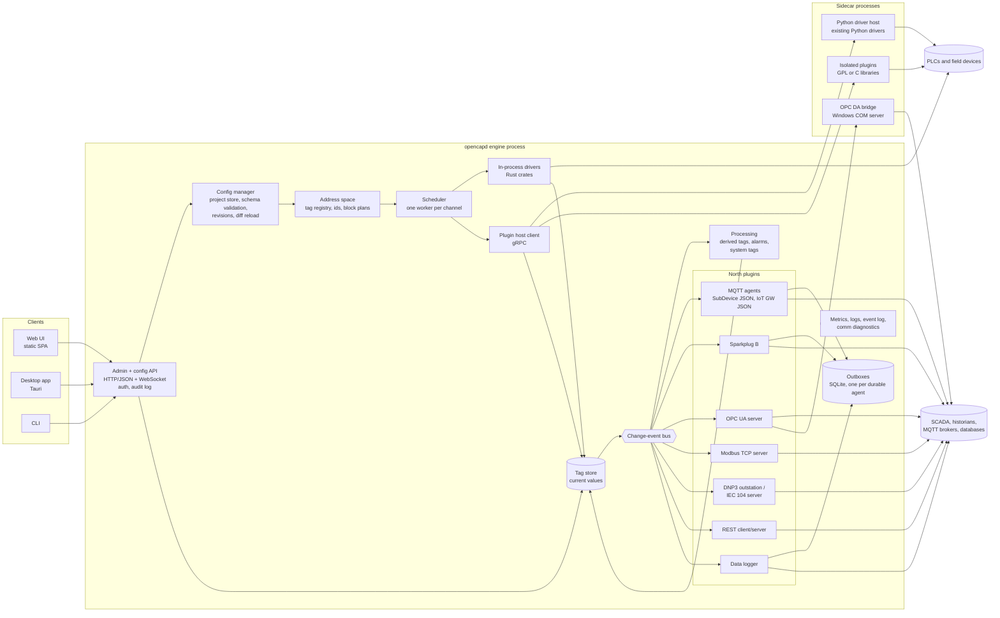
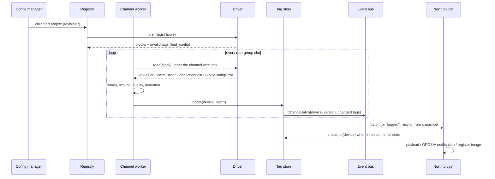

# 2. High-level design

## 2.1 Components

One engine process per node (`opencapd`), plus optional sidecar processes. The diagram is
the target; the Python reference implements the left half today (config, registry, channel
workers, Modbus/AB/PCCC drivers, cache, MQTT north with outbox, admin API, metrics).

| Component | Responsibility | Python today | Rust target |
|---|---|---|---|
| Config manager | Load, validate (shared JSON Schema), layer, diff, atomically persist, keep revisions | `config/loader.py`, `kep_import.py` | `opencap-core::config` |
| Address space / registry | Canonical tag paths, internal ids, rate groups, block plans | `core/registry.py` | `opencap-core` (registry) |
| Scheduler + channel workers | Rate groups, one request on the wire per channel, retries, backoff, demotion, stale | `core/scheduler.py`, `core/channel_worker.py` | `opencap-core` (scheduler, `ChannelWorker`) |
| Drivers | Protocol: pure `plan()`, one-attempt `read()`, `connect/close/identity/browse` | `drivers/*.py` | `engine/drivers/<name>` crates behind `driver-<name>` features, listed by the `opencap-drivers` registry (#67) + out-of-process plugins (#49) |
| Tag store | Current value, quality and timestamps of every tag; snapshots | `core/cache.py` (`ValueCache`) | `opencap-core` cache (global lock today); single-writer-per-device store of [ADR-0005](../adr/0005-north-plugins-tag-store-event-bus.md) in #41 |
| Change-event bus | Device-batch change events to every consumer; south never blocks on north | `on_cycle` callback | `on_cycle` today; bounded broadcast with conflation in #41 |
| Processing | Derived tags, alarms, system tags | — | `opencap-processing` (new crate, #55/#56) |
| North plugins | Publish/serve values to SCADA and IT systems | `north/` (MQTT) | `opencap-north` (MQTT, outbox, publisher); one crate per new north plugin |
| Outbox | Durable queue per agent that must not lose data | `north/saf.py` | same SQLite semantics (D-016, [ADR-0011](../adr/0011-store-and-forward-outbox-per-agent.md)) |
| Admin + config API | Status, values, demand read, reload, config CRUD, auth, audit | `api/server.py` (+ `web-ui` PR) | `opencap-api` (axum; same routes and auth) |
| Web UI | Configuration, Quick Client, diagnostics | `web-ui` PR | same bundle, served by the engine |
| Desktop app | Web UI in a native shell, local engine as sidecar, connect to remote nodes | — | `desktop/` (Tauri 2, [ADR-0010](../adr/0010-one-ui-web-and-tauri.md)) |
| Plugin host | Run drivers that are not Rust (Python reference drivers) or must stay out of process (GPL, unstable C libraries) | — | gRPC protocol ([ADR-0004](../adr/0004-driver-contract-and-plugin-model.md)) |
| OPC DA bridge | Windows COM server exposing the address space as OPC DA | — | separate Windows process ([ADR-0009](../adr/0009-scada-connectivity-strategy.md)) |

## 2.2 Data flow

1. **Configure.** The config manager validates the project against the shared schema
   ([ADR-0003](../adr/0003-shared-config-schema.md)), resolves layering and secrets
   (environment variable names only), and hands an immutable revision to the registry.
2. **Plan.** The registry calls each driver's pure `plan()`. Unusable tags become
   `bad_config` once and never reach the wire (D-001).
3. **Poll.** One worker per channel runs the rate groups. Each request takes the channel's
   FIFO wire lock (D-015). Retries, reconnect backoff (1 s → 60 s), demotion and stale
   marking are the worker's job, never the driver's.
4. **Store.** Results are scaled, given a quality and written to the tag store as one batch
   per block. The store bumps the device version.
5. **Notify.** The store emits one change event per batch. Consumers that fall behind are
   told they lagged and resynchronise from a snapshot; the scan loop never waits for them.
6. **Process.** Derived tags, alarms and system tags consume events and write their own
   outputs back to the store as virtual devices.
7. **Publish/serve.** North plugins turn events and snapshots into MQTT payloads, Sparkplug
   metrics, OPC UA data-change notifications, Modbus register images, database rows.
   Agents that must not lose data write to their own outbox first (D-016).

## 2.3 API contracts

| Contract | Where it is defined | Consumers | Versioning |
|---|---|---|---|
| Driver contract (plan/connect/read/close/identity/browse, error taxonomy) | Python: `src/opencap/drivers/base.py`; Rust: driver trait crate (RFC 0001); [03 §3.3](03-deep-dive.md#33-driver-contract) | core, plugin host | trait/ABC changes need an ADR |
| North plugin contract | [03 §3.5](03-deep-dive.md#35-north-plugin-contract) | all north plugins | ADR |
| Config schema (project, node settings) | JSON Schema in `schema/`, generated from the Pydantic models, consumed by Rust ([ADR-0003](../adr/0003-shared-config-schema.md)) | importer, loader, config API, UI forms, Rust engine | `version` field; additive changes are minor; breaking changes bump `version` and ship a migration |
| Admin + config REST API | OpenAPI document committed in `api/openapi.json` (issue on the board), drift-tested | UI, desktop, CLI, both engines | `/api/v1/…` prefix once the config API lands; additive only within v1 |
| Plugin protocol (out-of-process drivers/north) | `proto/opencap/plugin/v1/*.proto` (gRPC) | engine, plugin host, isolated plugins | package version `v1`, `v2`, … |
| Payload formats (SubDevice JSON, IoT Gateway JSON, Sparkplug B) | `docs/spec/payload-*.md` (SubDevice JSON today in the `north/payload.py` docstring) | MQTT consumers | format name + version in config |
| External tag path | `Channel.Device[.Group…].Tag`, KEPServerEX-compatible; OPC UA `ns=<idx>;s=<path>` ([ADR-0009](../adr/0009-scada-connectivity-strategy.md)) | every north server, UI, API | fixed |
| Quality and timestamps | [ADR-0006](../adr/0006-quality-and-timestamps.md) mapping table | every north server | ADR |

## 2.4 Storage

| Data | Store | Why |
|---|---|---|
| Project (channels, devices, tags, north agents, plug-ins) | JSON/YAML files in the config directory, written atomically (temp file + fsync + rename), previous revisions kept in `config/.revisions/` | Diffable, git-friendly, no database server on an edge box; see [ADR-0013](../adr/0013-project-file-v2.md) |
| Node settings (bind addresses, paths, instance name, names of secret env vars) | `poller.yaml` today (`node.yaml` in project v2) | Differ per node of a redundant pair; the project does not |
| Secrets | Environment variables or files named by config (done) | Never in config, logs, payloads, the repo |
| Current values | In memory (tag store) | Rebuilt by polling after a restart; stale until the first good read (done) |
| Outboxes | One SQLite file (WAL) per durable agent | Ordered, crash-safe, survives restarts (D-016) |
| Event log, audit log | Append-only JSON Lines with size-based rotation | Simple, greppable, shippable to a log system |
| Local historian (FR-6) | SQLite, time-partitioned tables | Embedded; external sinks for scale |
| OPC UA PKI | `pki/own`, `pki/trusted`, `pki/rejected`, `pki/issuers` | Standard OPC UA layout, manageable from the UI |

## 2.5 Deployment views

| View | Shape |
|---|---|
| Edge box (Linux) | `opencapd` as a systemd service, MQTT/Sparkplug to a central broker over VPN, OPC UA for a local HMI |
| Windows server next to SCADA | `opencapd` as a Windows service, OPC UA (and OPC DA bridge) to the SCADA on the same host |
| Container | Docker image (multi-arch), config and data volumes |
| Desktop all-in-one | Tauri app bundling `opencapd` as a sidecar: configure, test with the Quick Client, deploy the project to a node |
| Redundant pair | Two nodes, one active; standby does not poll ([ADR-0012](../adr/0012-redundancy-warm-standby.md)) |
| Large site | Several nodes, each owning a disjoint set of channels; the desktop app manages them all |
