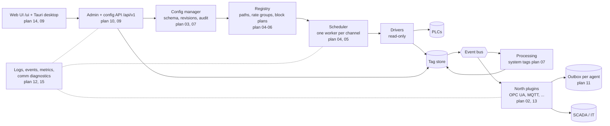

# Architecture to follow

How every feature in [`features/`](features/) is built. This file maps the KEPServerEX
concepts in the manual onto opencap's architecture and states the rules a contribution
must follow. It does not replace the normative documents; it points at them:

- [`docs/architecture/`](../docs/architecture/): requirements (FR-1 … FR-13), high-level
  design, deep dive (contracts), scale and reliability, trade-offs, roadmap (M1–M5);
- [`docs/adr/`](../docs/adr/): accepted decisions (ADR-0001 … 0014);
- [`docs/rfc/0001-rust-engine.md`](../docs/rfc/0001-rust-engine.md): the Rust engine, its
  KEPServerEX parity checklist (§7) and phases;
- [`docs/decisions.md`](../docs/decisions.md): every deviation and finding (D-001 …).

If this file and one of those disagree, **they win**; fix this file.

## 1. KEPServerEX concepts → opencap components

| KEPServerEX (manual) | opencap | Where it is decided | Plan file |
|---|---|---|---|
| Runtime service (polls devices, serves clients) | `opencapd` engine process: Rust is the production target, Python is the reference and conformance harness | ADR-0002, RFC 0001 | [01](features/01-runtime-and-process-modes.md) |
| Process modes (service / interactive), service ports, application data folders | systemd unit / Windows service / container / desktop sidecar; node settings in `poller.yaml` (`node.yaml` in project v2) | 02 §2.5, ADR-0013 | [01](features/01-runtime-and-process-modes.md) |
| Configuration client (Windows GUI) | One static web UI served at `/ui` by the engine, wrapped by the Tauri desktop app | ADR-0010 | [14](features/14-ui-and-tools.md) |
| Administration menu (system tray), settings pages | Web UI settings pages + authenticated API; service manager of the OS | ADR-0010, 03 §3.6 | [09](features/09-administration-and-security.md) |
| Project file (`.opf`, `.sopf`, `.json`) | Config directory: `devices.json`, `devices_map.yaml`, `overrides.yaml`, `poller.yaml` (project v2: one project document plus node settings), JSON Schema in `schema/` | ADR-0003, ADR-0013 | [03](features/03-projects-and-configuration-files.md) |
| Channel, device, tag, tag group, alias map | Config model (Pydantic ↔ serde, one schema) → registry (canonical paths, rate groups, block plans) → scheduler (one worker per channel) | ADR-0003, ADR-0004, D-015 | [04](features/04-channels.md), [05](features/05-devices.md), [06](features/06-tags-groups-aliases.md) |
| Device drivers (DLLs) | Driver contract: pure `plan()`, one-attempt `read()`, `connect/close/identity/browse`; Rust crates in process, gRPC plugins out of process | ADR-0004, 03 §3.3 | [04](features/04-channels.md), [05](features/05-devices.md) |
| System, property, statistics, modem and serialization tags | Processing layer: virtual devices written back to the tag store | ADR-0005, FR-10, #22 | [07](features/07-tag-management-and-system-tags.md) |
| CSV tag import/export | Importers next to `import-kep`; config API import/export | FR-9, #10 | [07](features/07-tag-management-and-system-tags.md) |
| Modem, phonebook, auto-dial (TAPI) | See the plan file's decision (legacy, Windows TAPI) | FR-1 | [08](features/08-communications-management.md) |
| Client interfaces: OPC UA, DA, AE, HDA, .NET, DDE, FastDDE/SuiteLink, iFIX, ThingWorx | North servers. OPC UA first; OPC DA through a Windows bridge; closed protocols not offered | ADR-0009, ADR-0005 | [02](features/02-client-interfaces.md), [13](features/13-ifix.md) |
| Store and Forward (ThingWorx, IoT Gateway) | One SQLite outbox per durable agent | ADR-0011, D-016 | [11](features/11-store-and-forward.md) |
| Configuration API service | `/api/v1` REST API: revisions/ETag, If-Match, audit log, named tokens; OpenAPI contract (#32) | 03 §3.6, D-039 … D-044 | [10](features/10-configuration-api.md) |
| User Manager, user groups, permissions | Named bearer tokens with viewer/admin roles today (D-040); full users/roles in the security RFC (#21) | D-040, D-062, RFC 0005 | [09](features/09-administration-and-security.md) |
| Certificate store | OPC UA PKI folders (`pki/own`, `trusted`, `rejected`, `issuers`), managed from the UI | 02 §2.4 | [09](features/09-administration-and-security.md) |
| Event log, OPC diagnostics, communication diagnostics | Structured JSON logs, audit log JSONL, `/health`, Prometheus `/metrics`, an event-log view in the UI, comm diagnostics capture | FR-10, 02 §2.4 | [12](features/12-diagnostics.md), [15](features/15-event-log-messages.md) |
| Quick Client (test client) | Device page with live values and read-once in the web UI; WebSocket live feed (#31) | ADR-0010, #31 | [14](features/14-ui-and-tools.md) |
| Plug-ins (Advanced Tags, Alarms, DataLogger, IoT Gateway, Redundancy, …) | Processing and north plugins on the tag store and event bus. Not in this manual: each has its own spec issue (#23, #24, #25, #36, #20) | ADR-0005, ADR-0012, M5 | — |
| Licensing and activation | None: opencap is Apache-2.0 | 01 "Out of scope" | — |

## 2. Layers and data flow

The target design is in [02 §2.1–2.2](../docs/architecture/02-high-level-design.md). In short:

1. **Configure:** validate against the shared schema, layer, keep a revision, audit the change.
2. **Plan:** each driver's pure `plan()`; unusable tags become `bad_config` once and never reach the wire.
3. **Poll:** one worker per channel, one request on the wire per channel, retries, backoff, demotion, stale.
4. **Store:** scaled values with quality and two timestamps, one batch per block.
5. **Notify:** one change event per batch; slow consumers resynchronise from a snapshot.
6. **Process:** system tags (and later derived tags, alarms) write back as virtual devices.
7. **Serve/publish:** north plugins; durable agents write to their outbox first.

## 3. Invariants (never broken by a feature)

1. **Read-only towards PLCs** ([ADR-0008](../docs/adr/0008-read-only-by-default.md)). No driver,
   north server or API route writes a PLC value. Manual features that write are `Out of scope`
   or wait for the write-safety RFC (#19). Changing opencap's own state (config, enable a
   device, acknowledge an alarm) is not a PLC write: allowed through the authenticated API,
   always audited.
2. **One request on the wire per channel** (D-015). Concurrency is per channel, never per device.
3. **One config contract** ([ADR-0003](../docs/adr/0003-shared-config-schema.md)). Every new
   setting goes into the Pydantic model, the generated JSON Schema, the Rust serde model and a
   conformance fixture in `tests/conformance/config/`; `compare.py` must stay green.
4. **Same behaviour in both engines** ([ADR-0002](../docs/adr/0002-rust-engine-python-reference.md)).
   Python defines behaviour; the Rust engine passes the same suites and vectors. Deliberate
   differences are written down in `docs/decisions.md`.
5. **Five qualities, two timestamps** ([ADR-0006](../docs/adr/0006-quality-and-timestamps.md)),
   one mapping table per north protocol.
6. **South never waits for north** ([ADR-0005](../docs/adr/0005-north-plugins-tag-store-event-bus.md)).
7. **No data loss for durable agents** ([ADR-0011](../docs/adr/0011-store-and-forward-outbox-per-agent.md)):
   outbox first, ordered, crash-safe.
8. **KEPServerEX-compatible naming** ([ADR-0009](../docs/adr/0009-scada-connectivity-strategy.md)):
   `Channel.Device[.Group…].Tag` everywhere (OPC UA `ns=<idx>;s=<path>`).
9. **Security defaults:** loopback bind without a token; with no token the API is read-only and
   answers only loopback host names; authentication before the body is read; bodies capped;
   secrets only in environment variables or files named by config, never in config, logs or
   payloads (D-019, D-040, D-062).
10. **Proven by simulators and vectors** ([ADR-0014](../docs/adr/0014-conformance-by-simulators-and-vectors.md)):
    every protocol has a simulator; behaviour is pinned by shared vectors; no test needs a real PLC.
11. **Licences** ([ADR-0007](../docs/adr/0007-oss-licence-policy.md)): permissive dependencies,
    named and linked at the pinned version; the licence gates stay green.
12. **Public repository:** no real site names, people, credentials or IP addresses (examples use
    192.0.2.x); `tests/unit/test_no_private_data.py` passes. The manual's text is not copied.

## 4. Where a feature goes

| The feature is … | It lives in … | It also needs … |
|---|---|---|
| a protocol / device family | a driver (Python reference + Rust crate, ADR-0004) | a simulator in `tests/helpers/`, conformance vectors, read-only guard test |
| a channel/device/tag setting | the config model (§3 rule 3) and the scheduler/worker or driver | importer mapping (`import-kep`, CSV), API field, UI form field |
| a value consumer (SCADA, IT, cloud) | a north plugin (ADR-0005), outbox if durable (ADR-0011) | quality mapping table, L1 compatibility test (ADR-0009) |
| a computed value (system/statistics tags) | the processing layer, as a virtual device | names in the system-tags spec (#22), metrics with the same data |
| an operator action or setting | an `/api/v1` route (role, audit entry, OpenAPI) | a UI page or control, a CLI command where it helps |
| something an operator must notice | a structured event (stable name, severity, fields, cause, fix) | a metric or `/health` field, the UI event-log view (plan 15) |

## 5. Definition of done for a feature

A row in [`checklist.md`](checklist.md) becomes `Done` when all of this is true:

1. **Spec:** the plan file's requirements are met; deviations are recorded in `docs/decisions.md`
   (next free number on `docs/BOARD.md`).
2. **Config:** schema regenerated, Rust model updated, conformance fixture added (if it adds settings).
3. **Python reference** implemented; **Rust** implemented, or the gap is recorded with its issue.
4. **Tests:** unit tests, simulator tests for wire behaviour, both-engine conformance where the
   Rust engine has the feature, UI smoke test for UI changes; `pytest -m "not acceptance"` green;
   acceptance suite run when core, a driver, north or the loader changed.
5. **Surfaces:** API route + OpenAPI, UI, event names and metrics as the plan file requires.
6. **Docs:** README / docs updated; new dependencies listed with licences.
7. **Process:** one issue, one PR, CI green, reviewed and merged by the lead (CONTRIBUTING).

## 6. Build order

Follows the milestones in [06 §6.1](../docs/architecture/06-roadmap-and-migration.md):

| Milestone | Plan areas it closes |
|---|---|
| **M1** Python parity for the reference project | remaining drivers (#73, #74); OPC UA server v1 (plan 02); config API + web UI v1 (plan 10, 14, done in #63) |
| **M2** Rust engine core | runtime and config parity (plan 01, 03, 04–06 in Rust; config conformance #39 done in #86); store-and-forward (plan 11); API parity (plan 10 runtime routes, #82 done) |
| **M3** Rust driver and SCADA parity | client interfaces in Rust (plan 02: OPC UA, Sparkplug, Modbus server) |
| **M4** Cut-over, desktop, installers | runtime modes and services (plan 01); desktop app (plan 14, #27 in review); project files v2 (plan 03, #37) |
| **M5** KEPServerEX plug-in parity | users/roles and permissions (plan 09, #21); system/statistics tags (plan 07, #22); diagnostics, comm capture and the event log view (plan 12, 15, #56; RFC 0001 §7); OPC DA bridge (plan 02, #18); redundancy (plan 05, #20) |

## 7. Deliberate differences from KEPServerEX

- **No writes** to PLCs (ADR-0008).
- **No closed or COM-only client interfaces** except an OPC DA bridge: no DDE, FastDDE,
  SuiteLink, iFIX native or ThingWorx native; OPC .NET and OPC HDA are out of scope
  (ADR-0009, 01 "Out of scope"). Each affected SCADA gets an OPC UA (or DA) recipe.
- **Configuration is plain files** (JSON/YAML, schema-validated, diffable, revisioned) instead
  of a binary project; KEPServerEX projects are imported (`import-kep`), not edited in place.
- **One web UI** for every platform (plus the desktop shell) instead of a Windows GUI.
- **Tokens and roles first** (viewer/admin), full users and groups in the security RFC (#21).
- **MQTT and OPC UA first** for northbound data.
- **No licensing, activation or time-limited demo mode.**
